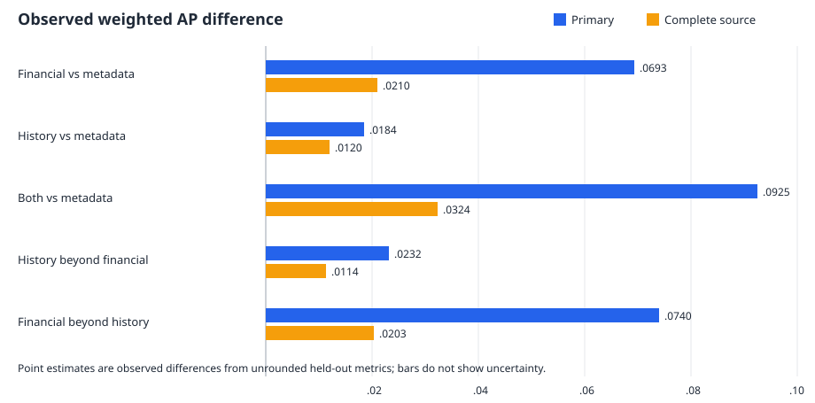
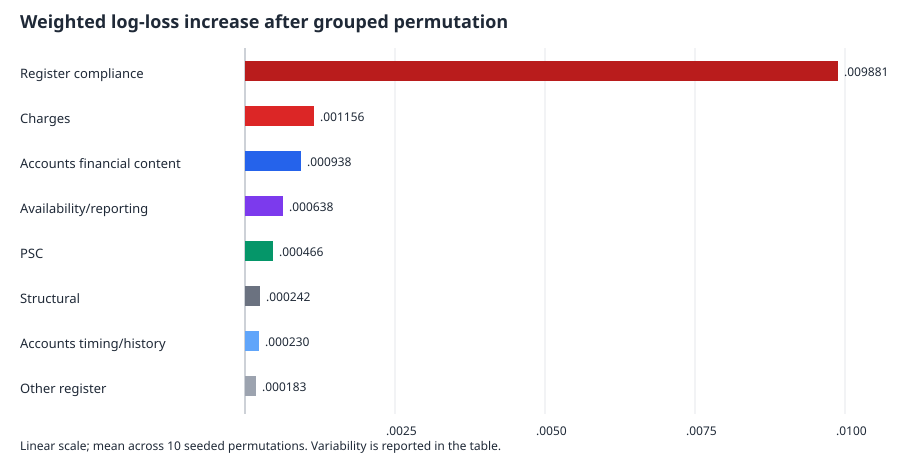

# Exploratory accounts ablation and feature importance

**Status:** completed internal exploratory follow-up. The held-out results had already been
inspected before this analysis was specified, so neither the ablations nor importance summaries are
confirmatory model-selection evidence. This remains contemporaneous classification of an adverse
status already recorded in the register; it is not future insolvency prediction.

## Frozen design and provenance

The analysis starts from the completed
[source-addition study](company-comparison-source-additions-results.md) and preserves its outcome
labels, deterministic company samples, train/test split, inclusion probabilities, weights,
preprocessing, regularisation grid and fail-fast convergence checks. No reusable fitted artifact
existed, so all models were refitted reproducibly from the frozen code at commit `511a605`.

The primary population contains 7,318 recorded-adverse and 5,589,063 comparison companies before
sampling. The complete-source sensitivity contains 4,881 recorded-adverse and 3,937,786 comparison
companies before sampling. Train/test sample identity hashes exactly match the source-addition run.
Register is dated 2026-10-01, PSC 2026-09-25 and accounts use registration month `T=202609`;
registration month is not monthly ZIP publication time.

The frozen accounts mapping assigns each of the 17 raw accounts predictors exactly once:

| group | columns | assignment notes |
|---|---|---|
| financial position/scale | equity, current assets, creditors within one year, net current assets, cash, current ratio, negative-equity flag, net-current-liabilities flag, employee band | Employee band is workforce scale despite categorical encoding; current ratio is financial rather than temporal. |
| financial change | changes in equity, net current assets and cash | Changes remain separate from levels. |
| recency/history | periods available, months since latest period end, prior period gap | Archive-resolution timing/history only; no exact filing timestamp is implied. |
| availability/reporting metadata | source presence, all 17 observation indicators, accounts category, employee-unit anomaly | Category describes filing regime; the anomaly is a parser/reporting diagnostic. Neither is treated as financial content. |

The common ablation baseline contains structural/register attributes plus every accounts
availability/reporting field. All four ablations therefore use identical availability indicators.
No raw column appears in more than one accounts content group.

## Difference reporting correction

The previous paired JSON field named `estimate` is the mean across bootstrap replicates, not the
observed held-out difference. Both existing study reports now use the difference calculated from
unrounded held-out metrics as the point estimate and retain the paired bootstrap percentile
interval. For example, register + accounts minus register has observed AP difference `0.11135021`;
the bootstrap mean is `0.10784981`, and the previously reported interval is unchanged. The new
aggregate records `observed_difference`, `bootstrap_mean` and `ci95` separately.

## Accounts ablations

All models selected `C=0.1` using training-only cross-validation. Higher ROC AUC/AP and lower log
loss/Brier score are better.

### Held-out metrics

| population | model | ROC AUC | weighted AP | log loss | Brier score |
|---|---|---:|---:|---:|---:|
| primary | metadata baseline | 0.96899 | 0.27904 | 0.005193 | 0.001080 |
| primary | + financial position/scale and change | 0.97183 | 0.34835 | 0.004844 | 0.001011 |
| primary | + recency/history | 0.96854 | 0.29748 | 0.005101 | 0.001062 |
| primary | + financial and recency/history | 0.97165 | 0.37153 | 0.004762 | 0.000993 |
| complete source | metadata baseline | 0.96084 | 0.31562 | 0.005256 | 0.001011 |
| complete source | + financial position/scale and change | 0.96546 | 0.33661 | 0.004962 | 0.000988 |
| complete source | + recency/history | 0.96024 | 0.32766 | 0.005222 | 0.001001 |
| complete source | + financial and recency/history | 0.96485 | 0.34797 | 0.004922 | 0.000974 |

### Paired observed differences

Point estimates are observed differences from unrounded metrics. Parentheses contain paired
bootstrap 95% intervals. Positive loss/Brier values are reductions and favour the candidate.

| population and comparison | ROC AUC (95% CI) | AP (95% CI) | log-loss reduction (95% CI) | Brier reduction (95% CI) |
|---|---:|---:|---:|---:|
| primary: financial vs metadata | 0.00284 (0.00039, 0.00524) | 0.06931 (0.03008, 0.10226) | 0.000348 (0.000245, 0.000455) | 0.000068 (0.000032, 0.000098) |
| primary: history vs metadata | -0.00045 (-0.00136, 0.00026) | 0.01844 (0.00393, 0.03552) | 0.000091 (0.000051, 0.000130) | 0.000018 (0.000004, 0.000032) |
| primary: both vs metadata | 0.00266 (0.00021, 0.00501) | 0.09249 (0.05309, 0.13131) | 0.000431 (0.000328, 0.000545) | 0.000087 (0.000049, 0.000126) |
| primary: history beyond financial | -0.00018 (-0.00085, 0.00059) | 0.02318 (0.01073, 0.03511) | 0.000083 (0.000050, 0.000117) | 0.000018 (0.000007, 0.000028) |
| primary: financial beyond history | 0.00311 (0.00093, 0.00524) | 0.07405 (0.03840, 0.10647) | 0.000340 (0.000256, 0.000446) | 0.000069 (0.000039, 0.000096) |
| complete: financial vs metadata | 0.00462 (0.00143, 0.00854) | 0.02099 (-0.04526, 0.08991) | 0.000294 (0.000058, 0.000477) | 0.000022 (-0.000081, 0.000087) |
| complete: history vs metadata | -0.00059 (-0.00149, 0.00034) | 0.01204 (-0.00114, 0.02840) | 0.000034 (0.000002, 0.000069) | 0.000009 (0.000000, 0.000019) |
| complete: both vs metadata | 0.00402 (0.00092, 0.00746) | 0.03235 (-0.03478, 0.10186) | 0.000334 (0.000102, 0.000519) | 0.000037 (-0.000055, 0.000104) |
| complete: history beyond financial | -0.00060 (-0.00119, 0.00010) | 0.01136 (-0.00513, 0.03042) | 0.000040 (-0.000004, 0.000087) | 0.000014 (-0.000004, 0.000037) |
| complete: financial beyond history | 0.00461 (0.00141, 0.00806) | 0.02031 (-0.04359, 0.08560) | 0.000300 (0.000096, 0.000468) | 0.000027 (-0.000049, 0.000089) |

**Finding:** financial content contributes most of the incremental separation. In the primary
population it improves all four metrics beyond metadata and beyond history. Timing/history adds a
smaller but resolved AP and loss/Brier improvement after financial content, while its ROC AUC
increment is slightly negative and unresolved. The complete-source sensitivity retains financial
ROC AUC and log-loss gains, but its AP and Brier intervals are wider and cross zero. The result is
therefore not “timing is irrelevant”: it contributes mainly to ranking among the rare positives and
to probabilistic loss rather than ROC ordering.

## Coefficients

Coefficients are conditional, regularised associations. Continuous columns use the frozen
signed-`log1p` or non-negative `log1p` transform and are scaled by the training standard deviation;
their odds ratios are per one training-SD increase in transformed value. Binary coefficients are
converted to a raw 0-to-1 odds ratio. Categorical variables use full one-hot encoding with no
omitted reference category; the displayed odds ratio is versus zero contribution to the linear
predictor, and a pairwise category contrast requires subtracting coefficients. It is not a
conventional category-versus-reference odds ratio.

Selected primary-population coefficients illustrate the main patterns; the committed JSON contains
all 1,698 aggregate coefficient rows across both populations.

| model | feature / level | signed log-odds effect | odds ratio | unit or interpretation |
|---|---|---:|---:|---|
| register | accounts overdue | 2.787 | 16.24 | raw false-to-true change |
| register | confirmation statement overdue | 2.656 | 14.24 | raw false-to-true change |
| register | registered charge count | 0.893 | 2.44 | one SD in `log1p(count)` |
| register + accounts | accounts overdue | 3.420 | 30.57 | raw false-to-true change |
| register + accounts | current assets | 0.615 | 1.85 | one SD in signed-`log1p(value)` |
| register + accounts | negative-equity flag | -0.526 | 0.59 | conditional raw false-to-true change |
| register + accounts | months since latest period end | -0.399 | 0.67 | one SD in signed-`log1p(months)` |
| register + PSC | PSC record count | 0.197 | 1.22 | one SD in `log1p(count)` |
| register + PSC | maximum voting band: 50–75% | 0.182 | 1.20 | full one-hot level; no omitted reference |
| register + PSC | maximum ownership band: 50–75% | 0.109 | 1.11 | full one-hot level; no omitted reference |
| register + PSC | verified PSC count | -0.099 | 0.91 | one SD in `log1p(count)` |
| all three | accounts overdue | 3.325 | 27.80 | raw false-to-true change |
| all three | current assets | 0.525 | 1.69 | one SD in signed-`log1p(value)` |
| all three | negative-equity flag | -0.647 | 0.52 | conditional raw false-to-true change |
| all three | maximum ownership band: 50–75% | 0.132 | 1.14 | full one-hot level; no omitted reference |

The negative conditional coefficient on the negative-equity flag is not evidence that negative
equity is protective. Equity, liquidity, filing category, missingness, company structure and
current adverse-process consequences are correlated; L2 regularisation distributes conditional
weight among them. This is exactly why coefficients are reported alongside held-out permutation
importance rather than interpreted alone.

## Held-out permutation importance

Each fitted model was frozen and never refitted during permutation. Ten seeded repetitions permuted
raw logical features through the fitted preprocessing pipeline, so categorical values always remain
valid observed categories. A directly derived flag and its source value share one permutation.
Observation indicators move with their owning feature in logical/content blocks. The separate broad
availability/reporting diagnostic moves presence, observation indicators and reporting metadata
together while holding content fixed; it is deliberately overlapping and non-additive, can create
counterfactual combinations, and is not a causal intervention.

The primary importance measure is weighted held-out log-loss increase; AP decrease is secondary.
The `±` values below are sample standard deviations across ten permutations, **not confidence
intervals over companies**. Correlated predictors can substitute for one another, so individual or
grouped importance can appear small even when the family contributes in an ablation.

### Broad groups in the all-three model

| rank | group | log-loss increase mean ± permutation SD | AP decrease mean ± permutation SD |
|---:|---|---:|---:|
| 1 | register compliance | 0.009881 ± 0.000302 | 0.3862 ± 0.0009 |
| 2 | charges | 0.001156 ± 0.000051 | 0.1711 ± 0.0201 |
| 3 | accounts financial content | 0.000938 ± 0.000053 | 0.1540 ± 0.0151 |
| 4 | availability/reporting | 0.000638 ± 0.000069 | 0.1134 ± 0.0210 |
| 5 | PSC | 0.000466 ± 0.000038 | 0.0894 ± 0.0108 |
| 6 | structural | 0.000242 ± 0.000031 | 0.0301 ± 0.0093 |
| 7 | accounts timing/history | 0.000230 ± 0.000031 | 0.0172 ± 0.0098 |
| 8 | other register | 0.000183 ± 0.000039 | 0.0104 ± 0.0226 |

### Main logical dependencies

| model | leading logical groups by log-loss increase |
|---|---|
| register only | register compliance 0.007052; charges 0.001664; SIC sections 0.000205; company type 0.000181 |
| register + accounts | register compliance 0.010040; charges 0.001182; working-capital/liquidity 0.000621; employee scale 0.000425; timing/history 0.000411 |
| register + PSC | register compliance 0.007436; charges 0.001447; PSC identity verification 0.000196; PSC record composition 0.000174; ownership/voting 0.000026 |
| all three | register compliance 0.009796; charges 0.001170; working-capital/liquidity 0.000468; employee scale 0.000416; reporting metadata 0.000241; timing/history 0.000226; PSC identity verification 0.000172 |

Working-capital/liquidity and employee scale are the most informative financial blocks after the
dominant filing-status and charge fields. Cash and financial changes have smaller positive
importance; the equity-position block is near zero when permuted conditionally alongside the rest
of the model, consistent with substitution by correlated liquidity, scale and reporting fields.
PSC identity-verification and record-composition blocks carry more held-out importance than
ownership/voting, although ownership/voting remains non-zero in the all-three model. These are
attributes of current recorded state and may reflect consequences of an adverse process already
under way.

## Validation and limitations

The run completed in 410.7 seconds (6m51s) and peaked at 2,448,160 KiB (2.33 GiB RSS). Promotion
checks verified the frozen input hashes, cohort, deterministic sample hashes, split, sampling
weights and definitions. All 126 cross-validation fits passed the fail-fast warning gate and all 14
final fits recorded zero convergence warnings. Validation checked ten paired ablation contrasts,
1,698 coefficient rows and 170 permutation blocks.

Targeted synthetic tests cover group closure, duplicate exclusion, observed-difference arithmetic,
shared grouped permutations, categorical integrity, unchanged source frames, weighted metrics,
sample identity preservation and aggregate-only output. The complete synthetic suite passed 289
tests with one deselected; Ruff reported no issues. No company-level assignments, predictions,
scores or permutation rows are committed.

Key limitations remain:

- the test partition was already inspected, so every result is exploratory;
- coefficient signs and permutation values are conditional on correlated predictors and L2
  regularisation; neither is causal or a stable production feature ranking;
- the availability diagnostic overlaps content-owner missingness blocks and is non-additive;
- missing accounts/PSC information differs by company structure and adverse status;
- financial, filing and PSC attributes are measured contemporaneously and can be consequences of
  an existing adverse process;
- the narrow outcome excludes ambiguous liquidation and the register base excludes previously
  dissolved companies.

The complete aggregate tables and provenance are in
[`company-comparison-accounts-importance-results.json`](company-comparison-accounts-importance-results.json).
The private promoted aggregate SHA-256 is
`e5575fe6c6e5126916e7835321bb690542bf3bf296a4aeb4532b10dd18d1b615`. No further model search,
production rule, threshold, score, ranking, download, push or publication was performed.
